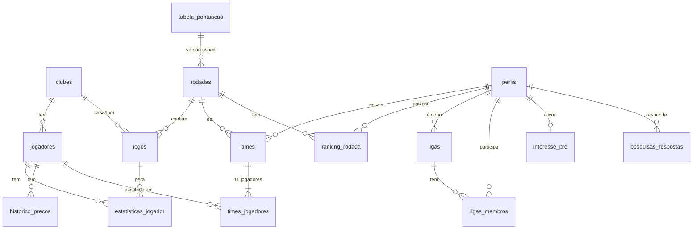

# Banco de Dados — Modelo e Campos

← [[Index]] · Contexto: [[Arquitetura]] · Origem dos dados: [[API-Football]] · Regras: [[Regras do Jogo]]

> [!abstract] Em uma frase
> **PostgreSQL (Supabase)** com **28 tabelas em 4 grupos**: catálogo esportivo espelhado da API-Football, jogo do usuário (time, saldo em C$ e passes), social e acesso (grupos, convites, lista de espera) e operação (jobs, configurações, avisos). O volume da validação é minúsculo (dezenas de milhares de linhas), e o plano grátis do Supabase (500 MB) sobra.

> [!info] Conferido contra `supabase/migrations/` em 06/11/2026
> 48 migrations. `interesse_pro` e `pesquisas_respostas` continuam **só no plano**: não foram criadas porque o fake door do PRO e a pesquisa não existem no app.

> [!note] Convenções
> - Nomes de tabela e coluna em **PT-BR, snake_case**, no plural para tabelas.
> - Tabelas espelhadas da API usam **o ID da API como chave primária** (`int`). Tabelas do app usam `uuid`.
> - Datas sempre em `timestamptz` (UTC no banco; exibição em `America/Sao_Paulo`).
> - Pontos e preços em `numeric`, **nunca `float`**, para o ranking não oscilar por arredondamento.
> - Todo registro tem `criado_em`; os que mudam têm `atualizado_em` (trigger).

---

## Diagrama

---

## Tipos enumerados

| Enum | Valores |
|---|---|
| `posicao` | `GOL`, `DEF`, `MEI`, `ATA` (a API só distingue G/D/M/F; ver [[Regras do Jogo]]) |
| `formacao` | `4-3-3`, `4-4-2`, `3-5-2` |
| `status_jogador` | `PROVAVEL`, `DUVIDA`, `LESIONADO`, `SUSPENSO` |
| `status_rodada` | `AGENDADA`, `ABERTA`, `EM_ANDAMENTO`, `FECHADA` |
| `status_jogo` | `A_JOGAR`, `EM_ANDAMENTO`, `ENCERRADO`, `ADIADO`, `CANCELADO` |
| `tipo_liga` | `CONVITE`, `ABERTA` |
| `tipo_sync` | `ELENCOS`, `LESOES`, `STATUS_RODADA`, `ESTATISTICAS_JOGO`, `CONFERENCIA_JOGO`, `FECHAMENTO_RODADA`, `PRECOS` |

**De `fixture.status.short` da API para `status_jogo`:** `TBD`, `NS` → `A_JOGAR` · `1H`, `HT`, `2H`, `ET`, `BT`, `P`, `INT`, `LIVE` → `EM_ANDAMENTO` · `FT`, `AET`, `PEN` → `ENCERRADO` · `PST`, `SUSP` → `ADIADO` · `CANC`, `ABD`, `AWD`, `WO` → `CANCELADO`.

---

## Grupo 1 · Catálogo esportivo (espelho da API-Football)

Escrita **só pelos jobs** (service role). Leitura pública.

### `clubes`

| Campo | Tipo | Regra | Origem |
|---|---|---|---|
| `id` | `int` PK | | `team.id` |
| `nome` | `text` not null | | `team.name` |
| `sigla` | `char(3)` unique not null | maiúsculas | `team.code` (**pode vir nulo**: preencher à mão) |
| `cor_primaria` | `char(7)` | hex `#RRGGBB` | **manual** (a API não fornece) |
| `cor_secundaria` | `char(7)` | hex | **manual** |
| `logo_url` | `text` | URL HTTPS opcional | `team.logo` |
| `ativo` | `bool` default `true` | clube na Série A da temporada | |
| `api_atualizado_em` | `timestamptz` | | job |

> [!warning] Uso do escudo
> A URL oficial de `team.logo` é guardada no catálogo para referência da integração. A interface continua usando a camisa genérica com `cor_primaria`/`cor_secundaria` até haver definição jurídica para exibição de escudos.

### `jogadores`

| Campo | Tipo | Regra | Origem |
|---|---|---|---|
| `id` | `int` PK | | `player.id` |
| `clube_id` | `int` FK → `clubes` not null | | `/players/squads` |
| `nome` | `text` not null | | `player.name` |
| `nome_exibicao` | `text` not null | até 16 caracteres, para o chip do campo | derivado (editável) |
| `numero` | `smallint` | | `player.number` |
| `posicao` | `posicao` not null | | `player.position` → G/D/M/F |
| `preco` | `numeric(5,2)` not null | `2,00 ≤ preco ≤ 20,00` | calculado |
| `preco_inicial` | `numeric(5,2)` not null | | calculado na carga |
| `media_temporada` | `numeric(5,2)` default 0 | | calculado |
| `media_ult5` | `numeric(5,2)` default 0 | média dos últimos 5 jogos com minutos > 0 | calculado |
| `jogos_temporada` | `smallint` default 0 | | calculado |
| `status` | `status_jogador` default `PROVAVEL` | | `/injuries?ids=` dos jogos da rodada aberta (JOA-163): "Missing Fixture" com "Red Card"/"Yellow Cards"/"Suspended" → `SUSPENSO`; "Missing Fixture" com lesão → `LESIONADO`; "Questionable" ou motivo "Inactive" → `DUVIDA`; fora da lista → `PROVAVEL`. Gravado por `fn_aplicar_status_jogadores`, a cada 6 h com a rodada aberta e uma vez nas 2 h antes da trava |
| `status_motivo` | `text` | ex.: "Lesão muscular", "Expulso", "3º amarelo" | `player.reason`, traduzido |
| `ativo` | `bool` default `true` | `false` quando sai do elenco | job |
| `api_atualizado_em` | `timestamptz` | | job |

Índices: `(clube_id)`, `(posicao, preco)`, `(ativo)`.

### `rodadas`

| Campo | Tipo | Regra | Origem |
|---|---|---|---|
| `id` | `serial` PK | | |
| `temporada` | `smallint` not null | ex.: 2026 | config |
| `numero` | `smallint` not null | 1–38 | extraído de `league.round` |
| `rotulo_api` | `text` not null | ex.: "Regular Season - 29" | `league.round` |
| `status` | `status_rodada` not null | | job |
| `abre_em` | `timestamptz` | quando a anterior fecha | job |
| `trava_em` | `timestamptz` not null | = menor `jogos.inicio_em` da rodada | job (**recalcular se houver remarcação**) |
| `fechada_em` | `timestamptz` | | job |
| `versao_regras` | `smallint` FK → `tabela_pontuacao.versao` not null | congela as regras da rodada | config |
| **Único** | `(temporada, numero)` | | |

### `jogos`

| Campo | Tipo | Regra | Origem |
|---|---|---|---|
| `id` | `int` PK | | `fixture.id` |
| `rodada_id` | `int` FK → `rodadas` not null | | |
| `clube_casa_id` | `int` FK → `clubes` not null | | `teams.home.id` |
| `clube_fora_id` | `int` FK → `clubes` not null | | `teams.away.id` |
| `inicio_em` | `timestamptz` not null | | `fixture.date` |
| `status` | `status_jogo` not null | | mapeado de `fixture.status.short` |
| `status_api` | `varchar(5)` | valor cru, para depuração | `fixture.status.short` |
| `gols_casa` | `smallint` | | `goals.home` |
| `gols_fora` | `smallint` | | `goals.away` |
| `pontuado_em` | `timestamptz` | 1ª leitura das estatísticas | job |
| `conferido_em` | `timestamptz` | 2ª leitura, no dia seguinte | job |
| `api_atualizado_em` | `timestamptz` | | job |

Índices: `(rodada_id)`, `(status, inicio_em)` (o job de polling procura "jogos que deveriam ter acabado").

### `estatisticas_jogador` (scouts por jogo)

Uma linha por jogador que **entrou em campo** num jogo.

| Campo | Tipo | Origem (`/fixtures/players` ou `/fixtures?id=`) |
|---|---|---|
| `jogo_id` | `int` FK → `jogos` · **PK composta** | `fixture.id` |
| `jogador_id` | `int` FK → `jogadores` · **PK composta** | `player.id` |
| `rodada_id` | `int` FK → `rodadas` (desnormalizado) | |
| `clube_id` | `int` FK → `clubes` | `team.id` |
| `minutos` | `smallint` | `games.minutes` |
| `posicao_jogo` | `char(1)` | `games.position` (G/D/M/F) |
| `substituto` | `bool` | `games.substitute`, ou entrou por evento `subst`, ou 0 minutos (a API costuma marcar todos como `false`) |
| `nota_api` | `numeric(3,1)` | `games.rating` (só exibição) |
| `gols` | `smallint` default 0 | `goals.total` |
| `assistencias` | `smallint` default 0 | `goals.assists` |
| `finalizacoes` | `smallint` default 0 | `shots.total` |
| `finalizacoes_no_gol` | `smallint` default 0 | `shots.on` |
| `desarmes` | `smallint` default 0 | `tackles.total` |
| `faltas_sofridas` | `smallint` default 0 | `fouls.drawn` |
| `faltas_cometidas` | `smallint` default 0 | `fouls.committed` |
| `impedimentos` | `smallint` default 0 | `offsides` |
| `amarelos` | `smallint` default 0 | `cards.yellow` |
| `vermelhos` | `smallint` default 0 | `cards.red` |
| `defesas` | `smallint` default 0 | `goals.saves` |
| `gols_sofridos` | `smallint` default 0 | `goals.conceded` |
| `penaltis_sofridos` | `smallint` default 0 | `penalty.won` |
| `penaltis_cometidos` | `smallint` default 0 | `penalty.commited` (grafia da API) |
| `penaltis_perdidos` | `smallint` default 0 | `penalty.missed` |
| `penaltis_defendidos` | `smallint` default 0 | `penalty.saved` |
| `gols_contra` | `smallint` default 0 | `/fixtures/events` `detail = "Own Goal"` |
| `sem_sofrer_gol` | `bool` | derivado: gols do adversário = 0 **e** `minutos ≥ 60` |
| `pontos` | `numeric(6,2)` not null | calculado com `tabela_pontuacao` |
| `versao_leitura` | `smallint` | 1 = fim do jogo · 2 = conferência |
| `payload_api` | `jsonb` | **resposta crua** do jogador, para auditoria e recálculo |
| `lido_em` | `timestamptz` | |

> [!important] Por que guardar o `payload_api`
> A API manda `null` em vez de 0 em vários campos, e os scouts são corrigidos depois do jogo. Com o JSON cru dá para recalcular a rodada inteira sem gastar requisição, que é escassa (100/dia). Tratar `null` como 0 **na carga**, nunca no cálculo.

Índices: `(rodada_id, jogador_id)` (soma da rodada), `(jogador_id, lido_em desc)` (média dos últimos 5).

### `tabela_pontuacao` (regras versionadas)

| Campo | Tipo | Regra |
|---|---|---|
| `versao` | `smallint` · **PK composta** | |
| `scout` | `text` · **PK composta** | ex.: `gols`, `desarmes`, `sem_sofrer_gol` |
| `posicao` | `posicao` · **PK composta** | uma linha por posição que pontua naquele scout |
| `pontos` | `numeric(4,2)` not null | ex.: 8,00 · −0,30 |
| `publicada_em` | `timestamptz` not null | |

A tabela da tela "Como Funciona" é lida daqui. Cada rodada aponta para a versão vigente (`rodadas.versao_regras`), então **mudar a regra no meio da temporada não altera rodada passada**.

### `historico_precos`

| Campo | Tipo | Regra |
|---|---|---|
| `jogador_id` | `int` FK · **PK composta** | |
| `rodada_id` | `int` FK · **PK composta** | preço **válido para** esta rodada |
| `preco` | `numeric(5,2)` not null | |
| `variacao` | `numeric(4,2)` not null | alimenta o ▲/▼ do mercado |

---

## Grupo 2 · Jogo do usuário

### `perfis`

O login fica em `auth.users` (Supabase Auth). Hoje o acesso é **só com Google**; o e-mail da conta é espelhado em `perfis.email` e conferido contra a lista de e-mails autorizados do convite. O `telefone` vem do plano original de login por SMS e não é mais preenchido.

| Campo | Tipo | Regra |
|---|---|---|
| `id` | `uuid` PK = `auth.users.id` | |
| `email` | `citext` | e-mail da conta Google, usado para autorizar o convite |
| `telefone` | `text` unique, nullable | legado do login por SMS; não é mais preenchido |
| `apelido` | `citext` unique not null | 3–20 caracteres, `^[A-Za-z0-9_.]+$`, filtro de palavrão |
| `clube_coracao_id` | `int` FK → `clubes` | alimenta o ranking "Por clube do coração" |
| `convidado_por` | `uuid` FK → `perfis` | primeiro convite que trouxe o usuário (métrica de viralidade) |
| `origem` | `text` | `utm_source` do primeiro acesso |
| `tema` | `text` default `escuro` | `escuro` / `claro` |
| `notificacoes_email` | `bool` default `true` | |
| `termos_versao` | `text` not null | |
| `termos_aceitos_em` | `timestamptz` not null | prova de aceite (LGPD) |
| `criado_em` · `atualizado_em` | `timestamptz` | |

### `times` (a escalação do usuário numa rodada)

| Campo | Tipo | Regra |
|---|---|---|
| `id` | `uuid` PK | |
| `usuario_id` | `uuid` FK → `perfis` not null | |
| `rodada_id` | `int` FK → `rodadas` not null | |
| `formacao` | `formacao` not null | |
| `custo` | `numeric(6,2)` not null | `≥ 0`; precisa caber no saldo da `carteira` (validado em `fn_salvar_escalacao`) |
| `pontos` | `numeric(7,2)` default 0 | soma de `times_jogadores.pontos` |
| `gols_escalados` | `smallint` default 0 | 2º critério de desempate |
| `salvo_em` | `timestamptz` not null | último salvamento antes da trava · 4º critério de desempate |
| `criado_em` · `atualizado_em` | `timestamptz` | |
| **Único** | `(usuario_id, rodada_id)` | 1 time por rodada no MVP |

### `times_jogadores`

| Campo | Tipo | Regra |
|---|---|---|
| `time_id` | `uuid` FK → `times` on delete cascade · **PK composta** | |
| `jogador_id` | `int` FK → `jogadores` · **PK composta** | |
| `posicao` | `posicao` not null | = `jogadores.posicao` |
| `preco_pago` | `numeric(5,2)` not null | **foto do preço** no momento do salvamento |
| `pontos` | `numeric(6,2)` default 0 | copiado de `estatisticas_jogador` quando o jogo do jogador acaba |
| `pontuado` | `bool` default `false` | alimenta "aguardando" × pontos no chip |

### Saldo em C$ (`carteiras` e `movimentacoes_saldo`)

Moeda do jogo, sem valor real. Regras em [[Regras do Jogo]].

| Tabela | Campos principais | Regra |
|---|---|---|
| `carteiras` | `usuario_id` (PK), `saldo` | criada por trigger ao criar o perfil; `saldo ≥ 0`, padrão C$ 60,00 |
| `movimentacoes_saldo` | `usuario_id`, `rodada_id`, `time_id`, `tipo`, `valor`, `saldo_antes`, `saldo_depois` | auditável; `RENDIMENTO` creditado no fechamento por `fn_creditar_saldos_rodada`, uma vez por usuário e rodada; `AJUSTE_SALDO_INICIAL` registrou a mudança de C$ 50 para C$ 60 |

### Passes de rodada (JOA-151)

Dinheiro real, sempre em centavos (`integer`). Não se mistura com o saldo em C$ de `carteiras`. Regras em [[2026-10-27 — Passes de rodada pagos]].

| Tabela | Campos principais | Regra |
|---|---|---|
| `produtos_passe` | `codigo` (`AVULSO`, `PACOTE_5`), `nome`, `quantidade`, `preco_centavos`, `ativo` | catálogo; 499 e 1999 |
| `pedidos` | `usuario_id`, `produto_id`, `valor_centavos`, `status`, `provedor_id` (único), `pago_em`, `nota_emitida_em` | `valor_centavos` é a **foto do preço**; `usuario_id` vira nulo se a conta for excluída |
| `passes_lotes` | `usuario_id`, `pedido_id` (único), `origem` (`COMPRA`, `CORTESIA`), `quantidade`, `restantes`, `valido_ate_temporada` | um lote por pedido; `restantes` entre 0 e `quantidade` |
| `passes_movimentacoes` | `usuario_id`, `lote_id`, `rodada_id`, `tipo` (`CREDITO`, `CONSUMO`, `ESTORNO`, `EXPIRACAO`), `quantidade` | **somente inserção**; um `CONSUMO` e um `ESTORNO` por usuário e rodada; `CONSUMO` e `ESTORNO` exigem rodada |

### `ranking_rodada` (materializado pelo job)

| Campo | Tipo | Regra |
|---|---|---|
| `rodada_id` | `int` FK · **PK composta** | |
| `usuario_id` | `uuid` FK · **PK composta** | |
| `pontos` | `numeric(7,2)` not null | |
| `posicao` | `int` not null | `RANK()` com os critérios de desempate |
| `posicao_anterior` | `int` | antes do último jogo pontuado → ▲/▼ |
| `atualizado_apos_jogo_id` | `int` FK → `jogos` | selo "atualizado após FLA × PAL" |

Índice: `(rodada_id, posicao)`.

---

## Grupo 3 · Social e validação

### `administradores`

Controle de acesso para o backoffice. Uma conta só ganha esse acesso por inclusão manual e confiável nesta tabela; o cliente nunca escolhe ou altera esse papel.

| Campo | Tipo | Regra |
|---|---|---|
| `usuario_id` | `uuid` PK FK → `perfis` | uma conta administrativa por perfil |
| `nome` | `text` not null | apelido do perfil no momento da inclusão |
| `telefone` | `text` not null unique | celular brasileiro verificado no perfil |
| `criado_em` | `timestamptz` | auditoria mínima |

### `ligas`

| Campo | Tipo | Regra |
|---|---|---|
| `id` | `uuid` PK | |
| `nome` | `text` not null | 3–40 caracteres |
| `icone` | `text` | emoji |
| `dono_id` | `uuid` FK → `perfis` not null | |
| `tipo` | `tipo_liga` default `CONVITE` | |
| `codigo_convite` | `varchar(8)` unique not null | alfanumérico sem caracteres ambíguos (sem 0/O, 1/I) |
| `token_convite` | `uuid` unique not null | usado no link público, não adivinhável |
| `convite_expira_em` | `timestamptz` | opcional; bloqueia o link depois do prazo |
| `temporada` | `smallint` not null | |
| `criada_em` · `arquivada_em` | `timestamptz` | |

### `ligas_membros`

| Campo | Tipo | Regra |
|---|---|---|
| `liga_id` | `uuid` FK → `ligas` on delete cascade · **PK composta** | |
| `usuario_id` | `uuid` FK → `perfis` · **PK composta** | |
| `convidado_por` | `uuid` FK → `perfis` | quem mandou o link (métrica de convite aceito) |
| `entrou_em` | `timestamptz` not null | |

O ranking da liga é calculado no servidor: a tela soma os pontos dos membros na rodada e reordena dentro do grupo; o do campeonato vem de `fn_ranking_campeonato`. Administradores ficam fora dos rankings. Grupos são criados e geridos **só pelo painel admin** (RLS libera `ligas` e `ligas_membros` apenas para administradores; o app lê pelo cliente de serviço depois de conferir que o usuário é membro).

### `ligas_convites_email` (e-mails autorizados)

| Campo | Tipo | Regra |
|---|---|---|
| `liga_id` | `uuid` FK → `ligas` · **PK composta** | |
| `email` | `text` · **PK composta** | minúsculo e sem espaços |
| `convidado_por` | `uuid` FK → `perfis` not null | gestor que autorizou |
| `usuario_id` | `uuid` FK → `perfis` | preenchido quando a pessoa entra |
| `aceito_em` | `timestamptz` | |

Só entra no grupo quem abre o link do convite logado com um e-mail desta lista.

### `lista_espera` (landing pública)

| Campo | Tipo | Regra |
|---|---|---|
| `nome` | `text` not null | 2–60 caracteres |
| `whatsapp` | `text` not null | 10 ou 11 dígitos |
| `email` | `citext` unique not null | |
| `consentimento_em` | `timestamptz` not null | aceite de contato |
| `origem` | `text` default `beta` | |
| `liga_id` · `aceito_em` · `aceito_por` | | decisão do admin ao aceitar a inscrição num grupo (JOA-169) |

Escrita e leitura só pelo servidor (service role). Ver [[Landing e Lista de Espera]].

> [!note] Planejadas, não criadas
> As duas tabelas abaixo são o desenho original do fake door do PRO e da pesquisa. Não existem no banco em 06/11/2026.

### `interesse_pro` (fake door)

| Campo | Tipo | Regra |
|---|---|---|
| `usuario_id` | `uuid` PK FK → `perfis` | 1 clique por usuário conta |
| `origem_tela` | `text` | de onde veio (Início, Ranking…) |
| `clicou_em` | `timestamptz` not null | |

### `pesquisas_respostas`

| Campo | Tipo | Regra |
|---|---|---|
| `id` | `uuid` PK | |
| `usuario_id` | `uuid` FK → `perfis` not null | |
| `pesquisa` | `text` not null | `apos_rodada_2`, `apos_rodada_4` |
| `nps` | `smallint` | 0–10 |
| `motivos` | `text[]` | opções marcadas |
| `pagaria_pro` | `bool` | "Pagaria R$ 9,90/mês?" |
| `comentario` | `text` | até 500 caracteres |
| `respondido_em` | `timestamptz` not null | |
| **Único** | `(usuario_id, pesquisa)` | |

---

## Grupo 4 · Operação

### `sync_execucoes` (log dos jobs e controle da cota da API)

| Campo | Tipo | Regra |
|---|---|---|
| `id` | `bigserial` PK | |
| `tipo` | `text` not null | `RODADA`, `JOGO`, `PONTUACAO` ou `ORQUESTRADOR` |
| `referencia` | `text` | ex.: `fixture=1234`, `rodada=29` |
| `iniciado_em` · `terminado_em` | `timestamptz` | |
| `requisicoes` | `smallint` not null | chamadas feitas nesta execução |
| `cota_restante` | `int` | lida do header de limite diário devolvido pela API |
| `sucesso` | `bool` not null | |
| `erro` | `text` | |

> [!important] Orçamento diário da API-Football (plano de 7.500 requisições/dia)
> O projeto conta o próprio consumo: `fn_requisicoes_api_football(início do dia UTC)` soma `requisicoes` do dia. Cada chamada é recusada antes de sair quando o consumo chega a `api_football_limite_diario` − `api_football_reserva_diaria` (7.500 − 500, em `configuracoes`), ou quando o cabeçalho `x-ratelimit-requests-remaining` da API, lido nos últimos 10 minutos, já está dentro da reserva. Leituras mais antigas são ignoradas, e uma execução barrada não regrava a leitura herdada (JOA-146): assim uma cota de uma chave já trocada não bloqueia o dia inteiro. Chave inválida ou limite atingido devolvidos pela API interrompem a execução. O erro devolvido pela API é gravado em `erro`.
>
> O log avisa (`[api-football] Consumo do dia passou de 50%/80%`) nos logs das Edge Functions.
>
> Implementado em `supabase/functions/_shared/api-football.ts` (JOA-63, JOA-145) e usado por `sync-round`, `score-match` e `advance-simulated-round`.

### Tentativas de pontuação em `jogos` (JOA-145)

| Campo | Tipo | Regra |
|---|---|---|
| `pontuacao_tentativas` | `smallint` not null default 0 | falhas seguidas ao pontuar ou conferir o jogo |
| `pontuacao_proxima_tentativa_em` | `timestamptz` | pausa crescente: 2, 4, 8, 16, 32 e depois 60 min |
| `pontuacao_ultimo_erro` | `text` | última mensagem de erro |

Depois de `api_football_max_tentativas_pontuacao` (10) falhas o jogo para de ser tentado; para tentar de novo, zere `pontuacao_tentativas`.

### `configuracoes`

Chave-valor para ajustes sem deploy: `temporada_atual` (2026), `temporada_fonte`, `liga_api_id` (71), `rodada_estreia` (33), `passes_obrigatorios` (desligada), `modo_simulacao` e `rodada_simulada_atual` (simulação de 2024, pausada), `orcamento` (não usado: o orçamento é o saldo da carteira, que começa em C$ 60), `api_football_limite_diario` (7500), `api_football_reserva_diaria` (500), `api_football_max_tentativas_pontuacao` (10), `pesquisa_ativa`.

### `versoes_pontuacao`

Versões publicadas da tabela de pontuação (`versao`, `publicada_em`). `rodadas.versao_regras` aponta para a versão usada na rodada. Leitura pública.

### Avisos da rodada (`avisos_whatsapp` e `push_inscricoes`)

| Tabela | Campos principais | Regra |
|---|---|---|
| `avisos_whatsapp` | `rodada_id`, `tipo` (`MERCADO_ABERTO`, `FALTA_1H`, `MERCADO_FECHADO`, `ESCALACAO_TARDIA`, `RODADA_ENCERRADA`), `mensagem`, `publico` (`TODOS`, `COM_TIME`, `SEM_TIME`), `push_enviado_em`, `enviado_em` | um aviso por rodada e tipo; enfileirado por trigger quando a rodada muda de status |
| `push_inscricoes` | `endpoint` (PK), `usuario_id`, `p256dh`, `auth` | uma inscrição por aparelho |

O nome `avisos_whatsapp` é histórico: o envio é só por push. Ver [[2026-11-02 — Avisos da rodada por push]].

---

## Regras no banco (funções e triggers)

| Nome | Tipo | O que garante |
|---|---|---|
| `fn_salvar_escalacao` | RPC | salva o time numa transação: formação, 11 jogadores, saldo da carteira, trava (`fn_rodada_editavel`), escalação tardia (`fn_escalacao_tardia_aberta`), lesionados e suspensos e passe |
| `fn_escalacao_tardia_aberta` · `fn_limite_escalacao_tardia` · `fn_jogo_iniciado` | funções | janela tardia: menos de 50% dos jogos começou; horário previsto para fechar |
| `fn_aplicar_status_jogadores` | função | aplica Provável, Dúvida, Lesionado e Suspenso vindos da API |
| `fn_pontuar_jogo(jogo_id)` | função | calcula `estatisticas_jogador.pontos`, copia para `times_jogadores`, soma em `times`, regrava `ranking_rodada` |
| `fn_inicializar_ranking_rodada` · `fn_ranking_rodada` · `fn_ranking_campeonato` | funções e RPC | ranking da rodada e acumulado da temporada, sem administradores |
| `fn_atualizar_precos(rodada_id)` | função | recalcula médias e preço e grava `historico_precos` para a rodada seguinte |
| `fn_creditar_saldos_rodada(rodada_id)` | função | credita `max(pontos − preço pago, 0)` por jogador na carteira, uma vez por rodada |
| `fn_enfileirar_aviso_status_rodada` · `fn_enfileirar_aviso_fechamento` | trigger e função | põem os avisos da rodada na fila de push |
| `fn_requisicoes_api_football` · `fn_temporada_atual` | funções | consumo diário da API e temporada vigente |
| `fn_passes_disponiveis()` | RPC | total de passes do usuário autenticado ainda válidos na `temporada_atual` |
| `fn_passe_libera_rodada(rodada_id)` | RPC | se o usuário pode salvar na rodada: chave desligada, administrador, rodada simulada ou passe válido na temporada da rodada |
| `fn_passe_exigido(rodada_id)` | RPC | se a rodada exige passe do usuário: chave ligada, não administrador e rodada não simulada; usada pela tela de escalação |
| `fn_consumir_passes_rodada(rodada_id)` | função | na trava, debita 1 passe por time salvo, do lote que vence antes; expira lotes vencidos; idempotente |
| `fn_estornar_passes_rodada(rodada_id)` | função | devolve o passe se todos os jogos da rodada foram adiados ou cancelados; idempotente |
| `fn_expirar_passes()` | função | zera lotes vencidos e registra `EXPIRACAO` |
| `perfis_conceder_cortesia_passes` | trigger | 2 passes de cortesia ao criar o perfil, válidos até a temporada seguinte |

---

## Segurança (Row Level Security do Supabase)

| Tabela | Leitura | Escrita |
|---|---|---|
| `clubes`, `jogadores`, `rodadas`, `jogos`, `estatisticas_jogador`, `tabela_pontuacao`, `historico_precos` | pública | só service role (jobs) |
| `perfis` | `apelido` e `clube_coracao_id` públicos (ranking); o resto só o próprio | o próprio |
| `times`, `times_jogadores` | o próprio sempre; **os outros só depois da trava** (ninguém copia o time alheio antes do jogo) | o próprio, antes da trava |
| `ranking_rodada` | pública | service role |
| `ligas`, `ligas_membros` | administradores (o app lê pelo servidor após conferir o vínculo) | administradores |
| `ligas_convites_email`, `lista_espera` | service role | service role |
| `carteiras`, `movimentacoes_saldo` | o próprio | service role e funções `security definer` |
| `versoes_pontuacao` | pública | service role |
| `produtos_passe` | pública | service role |
| `pedidos`, `passes_lotes` | o próprio | service role e funções `security definer` |
| `passes_movimentacoes` | o próprio | somente inserção por service role e funções `security definer` |
| `sync_execucoes`, `configuracoes` | service role | service role |
| `avisos_whatsapp`, `push_inscricoes` | service role | service role e funções `security definer` |

A **chave da API-Football nunca vai para o front**: só os jobs no servidor a usam.

---

## Volume esperado (validação: 500 usuários, 6 rodadas)

| Tabela                 |                                    Linhas |
| ---------------------- | ----------------------------------------: |
| `clubes`               |                                        20 |
| `jogadores`            |                                      ~600 |
| `jogos`                |                          380 na temporada |
| `estatisticas_jogador` |       ~30 por jogo → ~11.400 na temporada |
| `times`                |                                    ~3.000 |
| `times_jogadores`      |                                   ~33.000 |
| `ranking_rodada`       |                                    ~3.000 |
| **Total**              | **< 100 mil linhas, bem abaixo de 50 MB** |

---

## LGPD: dados pessoais guardados

**E-mail da conta Google** (em `auth.users` e espelhado em `perfis`), **apelido**, **clube do coração** e **origem**. Na lista de espera: **nome, WhatsApp e e-mail**, com data do consentimento. Inscrições de push guardam o endpoint do aparelho. **Sem CPF ou endereço na validação.** A exclusão de conta é pedida ao administrador do grupo (a exclusão pelo app está desligada) e, quando feita pela action `deleteAccount`:
- apaga `auth.users` e `perfis` (carteira, passes e inscrições de push saem em cascata);
- mantém as linhas de ranking das rodadas passadas **anonimizadas** ("Jogador removido"), para a classificação dos outros não mudar.

Os `pedidos` **são mantidos** depois da exclusão, sem vínculo com o usuário, por serem registro fiscal. Lotes e movimentações de passes são apagados.

Quando entrar prêmio, a tabela `perfis` ganha CPF (criptografado) e chave PIX validada contra o CPF. Ver [[Jurídico e Riscos]].

---

*Criado em 28/09/2026. Atualizado em 06/11/2026, conferido contra as migrations. Campos da API conforme a documentação pública da API-Football v3: **conferir contra a resposta real** no primeiro teste com a chave grátis.*
